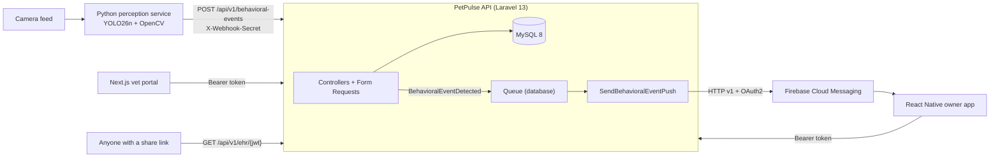
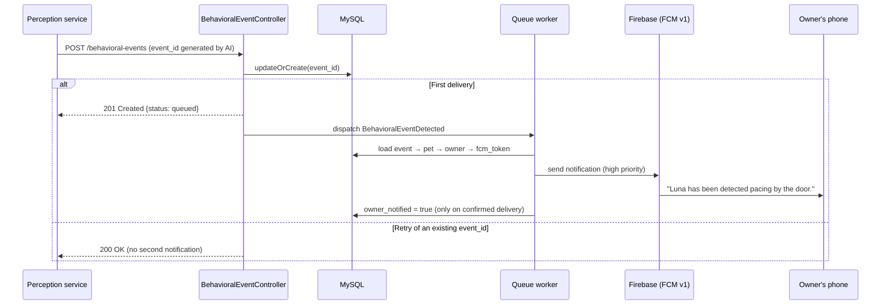
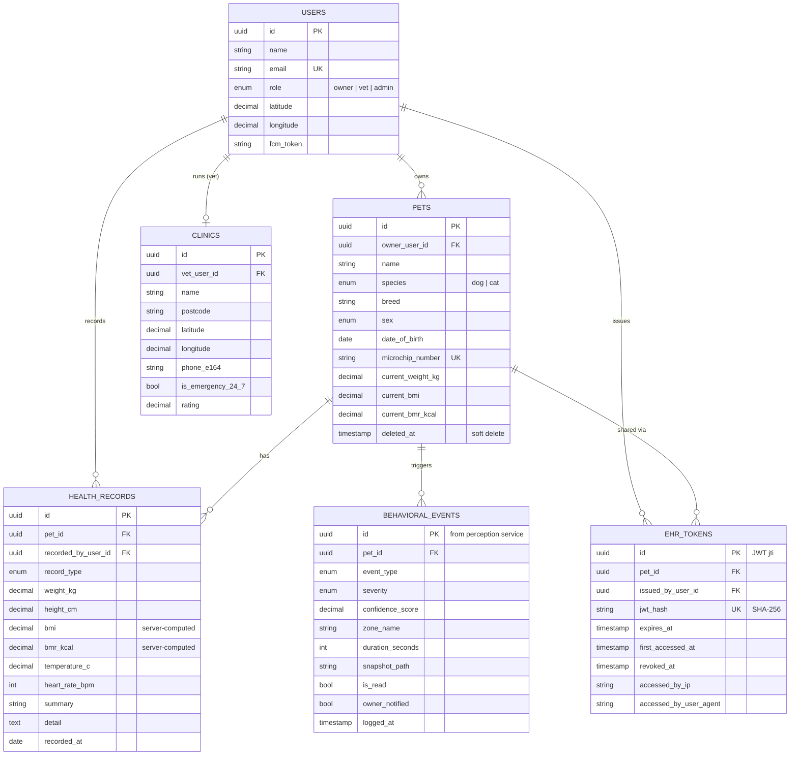

# PetPulse API

[](https://github.com/CodeAbbas/PetPulse-API/actions/workflows/ci.yml)


**PetPulse API** is the headless REST backend for the *Smart Pet Care & Monitoring Ecosystem*, a system that combines computer-vision behaviour monitoring, veterinary health records and emergency clinic triage for dogs and cats.

It is the **contract authority** of a three-part system. It authenticates owners, vets and administrators. It stores pet profiles and clinical records and computes biometric metrics on the server. It ingests behavioural alerts from an edge AI camera service, sends real-time push notifications to owners' phones, and issues secure, time-limited links for sharing electronic health records (EHRs).

> Final-year project for the BSc (Hons) Computing Systems degree at Ulster University (module COM668).

## Related repositories

PetPulse is one project split across three repositories:

| Repository | Role |
|---|---|
| [**PetPulse-API**](https://github.com/CodeAbbas/PetPulse-API) *(this repository)* | Laravel REST API: authentication, pet and health records, webhook ingestion, push notifications and EHR sharing |
| [**petpulse-frontend**](https://github.com/CodeAbbas/petpulse-frontend) | Next.js veterinarian portal (`apps/web`) and React Native owner app (`apps/mobile`) |
| [**petpulse-ai**](https://github.com/CodeAbbas/petpulse-ai) | Python edge perception service (YOLO26n and OpenCV) that detects pet behaviour and sends events to this API |

---

## Contents

- [Key features](#key-features)
- [System architecture](#system-architecture)
- [Technology stack](#technology-stack)
- [Getting started](#getting-started)
- [Configuration](#configuration)
- [API reference](#api-reference)
- [Data model](#data-model)
- [Roles and permissions](#roles-and-permissions)
- [Security design](#security-design)
- [Testing](#testing)
- [Continuous integration](#continuous-integration)
- [Project structure](#project-structure)
- [Architecture decision records](#architecture-decision-records)
- [Known limitations and roadmap](#known-limitations-and-roadmap)
- [Author](#author)

---

## Key features

| Requirement | Feature | What the API does |
|---|---|---|
| **FR-01** | Role-based authentication | Laravel Sanctum bearer tokens with three roles: `owner`, `vet`, `admin`. Public registration always creates an `owner`, so privileged roles can never be self-assigned. |
| **FR-02** | Pet profiles | Create, read, update and soft-delete dog and cat profiles (species, breed, sex, date of birth, microchip number). The owner is taken from the authenticated user, never from request input. |
| **FR-03** | Server-side biometrics | Every health record gets **BMI** and **BMR** (resting energy requirement) computed on the server by a pure, unit-tested domain service. Any BMI or BMR value in the request is ignored. |
| **FR-04** | Edge AI webhook ingestion | A machine-to-machine endpoint receives behavioural events (pacing, vocalisation, prolonged waiting and others) from the Python perception service. It is **idempotent**: a retried event is updated, not duplicated. |
| **FR-05** | EHR share-link issuance | Vets issue HS256-signed, time-expiring JWT share links for a pet's record. Only a **SHA-256 hash** of the token is stored. |
| **FR-06** | Public EHR viewer | Anyone holding a valid link can open the pet's clinical record without logging in. The first access is audit-logged with IP address, user agent and timestamp. |
| **FR-07** | Real-time owner alerts | New behavioural events trigger a **Firebase Cloud Messaging (HTTP v1)** push to the owner's device. This happens on a queued listener, so Firebase latency never blocks the webhook. |
| **FR-08** | Smart Triage clinic finder | Lists vet clinics, with an optional 24/7-emergency filter and nearest-first sorting by **Haversine** great-circle distance from the caller's coordinates. |
| **FR-09** | Weight trajectory support | Health records can be filtered by pet and returned as a full, ordered history for charting. |

---

## System architecture

PetPulse API is one of three components in the ecosystem:

| Component | Responsibility |
|---|---|
| **PetPulse API** *(this repository)* | Laravel REST API, data persistence, authorisation, notification fan-out. The single source of truth for the API contract. |
| **[Perception service](https://github.com/CodeAbbas/petpulse-ai)** | Python edge AI service (YOLO26n and OpenCV) that watches a camera feed, detects pet behaviour by zone, and posts events to this API's webhook. |
| **[Frontend clients](https://github.com/CodeAbbas/petpulse-frontend)** | A Next.js veterinarian portal (including the public EHR viewer) and a React Native owner app (alerts, triage map, pet profiles). |



### Alert pipeline

The webhook response does **not** wait for Firebase. The controller writes the event, dispatches a domain event and returns straight away. A queue worker then delivers the push notification ([ADR-0007](docs/adr/0007-asynchronous-notification-queueing.md)).



---

## Technology stack

| Layer | Technology |
|---|---|
| Language and runtime | PHP 8.3 (strict types throughout) |
| Framework | Laravel 13 |
| Authentication | Laravel Sanctum 4 (personal access tokens) |
| Database | MySQL 8.0, with UUID v4 primary keys on all domain tables |
| Queue | Laravel queues (`database` driver by default) |
| Push notifications | Firebase Cloud Messaging HTTP v1, using `google/auth` for service-account OAuth2 |
| Testing | PHPUnit 12, Mockery, model factories |
| Code style | Laravel Pint (PSR-12) |
| CI and maintenance | GitHub Actions, Dependabot (Composer and Actions, weekly) |

---

## Getting started

### Prerequisites

- **PHP 8.3+** with `pdo_mysql`, `mbstring`, `bcmath`, `intl` and `fileinfo`
- **Composer 2**
- **MySQL 8.0** (or a compatible MariaDB)
- **Node.js 20 LTS+**: optional, only needed for the `composer dev` helper and Vite assets. No frontend code lives here.

> **MySQL is required.** One migration (`add_prolonged_waiting_to_behavioral_events_enum`) uses MySQL-specific `ALTER TABLE … MODIFY COLUMN` syntax, so migrations **fail on SQLite**. That includes the `DB_CONNECTION=sqlite` default in `.env.example`.

### 1. Clone and install

```bash
git clone https://github.com/CodeAbbas/PetPulse-API.git
cd PetPulse-API
composer install
cp .env.example .env
php artisan key:generate
```

### 2. Configure the environment

Create a database, then edit `.env`:

```dotenv
DB_CONNECTION=mysql
DB_HOST=127.0.0.1
DB_PORT=3306
DB_DATABASE=petpulse
DB_USERNAME=root
DB_PASSWORD=secret

QUEUE_CONNECTION=database

# Shared secret the perception service sends in X-Webhook-Secret
WEBHOOK_SECRET=change-me-to-a-long-random-string

# Where the public EHR viewer lives (used to build share URLs)
FRONTEND_URL=http://localhost:3000

# Firebase (optional: pushes are skipped and logged if absent)
FCM_CREDENTIALS_PATH=storage/app/firebase/google-service-account.json
FCM_PROJECT_ID=your-firebase-project-id
```

See [Configuration](#configuration) for every variable.

### 3. Migrate and seed

```bash
php artisan migrate --seed
```

The seeders create one account for each role, three London emergency clinics and a sample pet:

| Role | Email | Password |
|---|---|---|
| Owner | `sarah.mitchell@example.com` | `password` |
| Vet | `alex.vance@vetsnow.example` | `password` |
| Admin | `admin@petpulse.local` | `password` |

> These are **development-only** credentials. Do not seed them into any shared or public environment.

### 4. Run the application

Push notifications are sent from a queued listener, so you need a **queue worker** as well as the web server:

```bash
# Terminal 1: HTTP server on http://localhost:8000
php artisan serve

# Terminal 2: processes FCM push jobs
php artisan queue:work
```

Alternatively, run everything (server, queue listener, log tail and Vite) in one terminal:

```bash
composer dev
```

Check that the app is up:

```bash
curl -i http://localhost:8000/up      # 200 OK
```

### 5. Make your first request

```bash
# Log in as the seeded owner
curl -s -X POST http://localhost:8000/api/v1/auth/login \
  -H "Accept: application/json" -H "Content-Type: application/json" \
  -d '{"email":"sarah.mitchell@example.com","password":"password","device_name":"cli"}'

# Use the returned token
curl -s http://localhost:8000/api/v1/pets \
  -H "Accept: application/json" -H "Authorization: Bearer <token>"
```

---

## Configuration

These variables are specific to PetPulse, on top of the standard Laravel ones:

| Variable | Default | Purpose |
|---|---|---|
| `APP_KEY` | *(generated)* | Laravel encryption key. **Also the HMAC key that signs EHR share-link JWTs**, so rotating it invalidates every outstanding share link. |
| `DB_CONNECTION` | `sqlite` in `.env.example` | Must be set to `mysql` (see [Prerequisites](#prerequisites)). |
| `QUEUE_CONNECTION` | `database` | `database` or `redis` in production. With `sync`, FCM calls run inside the webhook request and bring back the latency the queue exists to avoid. |
| `WEBHOOK_SECRET` | *(none)* | Shared secret for `POST /behavioral-events`. If unset, **every webhook request is rejected** with `401`. |
| `FRONTEND_URL` | `http://localhost:3000` | Base URL used to build EHR `share_url` values (`{FRONTEND_URL}/ehr/{jwt}`). |
| `FCM_CREDENTIALS_PATH` | `storage/app/firebase/google-service-account.json` | Path to a Firebase service-account JSON file, relative to the project root. Keep this file out of version control. |
| `FCM_PROJECT_ID` | *(a project default)* | Firebase project ID. Set it to your own project. |
| `SANCTUM_STATEFUL_DOMAINS` | Laravel default | Domains allowed to use cookie-based Sanctum sessions. |

CORS is configured in `config/cors.php` and currently allows `http://localhost:3000` only. Add your deployed frontend origins there.

---

## API reference

### Conventions

| | |
|---|---|
| **Base URL** | `http://localhost:8000/api/v1` |
| **Headers** | `Accept: application/json` on every request; `Content-Type: application/json` on requests with a body |
| **Authentication** | `Authorization: Bearer <token>` (Sanctum personal access token) |
| **IDs** | All resource IDs are UUID v4 strings |
| **Timestamps** | ISO 8601 with UTC offset, for example `2026-11-20T09:15:00+00:00` |
| **Envelope** | Successful responses wrap their payload in `data`, with optional `meta` |
| **Rate limit** | Authenticated routes: **60 requests per minute** per user (per IP when unauthenticated). Excess requests get `429 Too Many Requests`. |

#### Error responses

| Status | When | Body |
|---|---|---|
| `401` | Missing or invalid bearer token, or wrong webhook secret | `{"message": "Unauthenticated."}` |
| `403` | Authenticated, but the role or ownership rules forbid the action | `{"message": "…"}` |
| `404` | Resource not found, or an invalid, expired or revoked EHR link | `{"message": "…"}` |
| `422` | Validation failed | `{"message": "…", "errors": {"field": ["…"]}}` |
| `429` | Rate limit exceeded | `{"message": "Too Many Attempts."}` |

### Endpoint summary

| Method | Path | Auth | Description |
|---|---|---|---|
| `POST` | `/auth/register` | Public | Register an owner account and receive a token |
| `POST` | `/auth/login` | Public | Log in and receive a token |
| `POST` | `/auth/logout` | Bearer | Revoke the current token |
| `GET` | `/auth/me` | Bearer | Get the authenticated user |
| `POST` | `/auth/fcm-token` | Bearer | Register or replace the device's FCM push token |
| `GET` | `/pets` | Bearer | List pets |
| `POST` | `/pets` | Bearer | Create a pet owned by the caller |
| `GET` | `/pets/{pet}` | Bearer | Get a pet |
| `PUT`/`PATCH` | `/pets/{pet}` | Bearer | Update a pet |
| `DELETE` | `/pets/{pet}` | Bearer | Soft-delete a pet |
| `GET` | `/health-records` | Bearer | List health records (scoped by role) |
| `POST` | `/health-records` | Bearer (owner, vet) | Create a record with server-computed BMI and BMR |
| `GET` | `/health-records/{id}` | Bearer | Get a record |
| `DELETE` | `/health-records/{id}` | Bearer (admin) | Delete a record |
| `GET` | `/clinics` | Bearer | List clinics, with optional emergency filter and proximity sort |
| `GET` | `/clinics/{clinic}` | Bearer | Get a clinic |
| `POST` | `/pets/{pet}/ehr-token` | Bearer (vet, admin) | Issue a time-limited EHR share link |
| `GET` | `/ehr/{jwt}` | **Public** (signed token) | View a shared EHR |
| `POST` | `/behavioral-events` | `X-Webhook-Secret` | Ingest a behavioural event from the perception service |
| `GET` | `/up` *(no `/api/v1` prefix)* | Public | Health check |

---

### Authentication

#### `POST /auth/register`

Creates an **owner** account. A `role` field in the body is ignored.

| Field | Rules |
|---|---|
| `name` | required, 2–120 characters |
| `email` | required, valid RFC email, unique, ≤ 180 characters |
| `password` | required, ≥ 8 characters, mixed case and at least one number |
| `password_confirmation` | required, must match `password` |
| `device_name` | optional, labels the issued token (default `default-device`) |

**`201 Created`**

```json
{
  "data": {
    "user": {
      "id": "9b1c4c1e-3f0a-4a2e-9a55-6f1f2b7d8e10",
      "name": "Jane Doe",
      "email": "jane@example.com",
      "role": "owner"
    },
    "token": "3|r2Yx…"
  },
  "meta": { "token_type": "Bearer" }
}
```

#### `POST /auth/login`

Body: `email`, `password`, optional `device_name`. Returns `200` with the same shape as registration. A wrong password and an unknown email both give the same `422` error, so the response does not reveal which accounts exist.

#### `POST /auth/logout`

Revokes only the token used for this request. Other devices stay signed in.

#### `GET /auth/me`

Returns `{ "data": { "user": { "id", "name", "email", "role" } } }`.

#### `POST /auth/fcm-token`

```json
{ "fcm_token": "<firebase-device-registration-token>" }
```

Stores the caller's push token (≤ 512 characters). Each user has **one** token, so registering a new device replaces the previous one ([ADR-0006](docs/adr/0006-fcm-token-topology.md)).

---

### Pets

#### `POST /pets`

| Field | Rules |
|---|---|
| `name` | required, ≤ 80 characters |
| `species` | required, `dog` or `cat` |
| `breed` | optional, ≤ 100 characters |
| `sex` | optional, `male`, `female` or `unknown` |
| `date_of_birth` | optional date, not in the future |
| `microchip_number` | optional, ≤ 20 characters, unique |

`owner_user_id` is always set to the authenticated user.

#### Pet resource (`GET /pets/{pet}`)

```json
{
  "data": {
    "id": "1d4a9b17-48fc-4a1e-b242-4cbb0239440b",
    "name": "Luna",
    "species": "dog",
    "breed": "Labrador Retriever",
    "sex": "female",
    "date_of_birth": "2023-04-12",
    "age_years": 3,
    "microchip_number": "956000012345678",
    "metrics": {
      "current_weight_kg": 28.5,
      "current_bmi": 22.1,
      "current_bmr_kcal": 1450
    },
    "owner": { "id": "d99e6c7d-4135-49af-8727-264c6795ccb6" },
    "timestamps": {
      "created_at": "2026-11-20T00:14:11+00:00",
      "updated_at": "2026-11-20T00:14:11+00:00"
    }
  }
}
```

To keep personal data to a minimum (GDPR Art. 5(1)(c)), the owner appears as an ID only. `GET /pets` returns `{ "data": [ … ], "meta": { "total": n } }`. `DELETE /pets/{pet}` soft-deletes the pet and returns `204 No Content`; its health records are kept.

---

### Health records

#### `POST /health-records`

| Field | Rules |
|---|---|
| `pet_id` | required, UUID of an existing, non-deleted pet |
| `record_type` | required: `weight`, `vaccination`, `examination`, `lab_work`, `dental`, `surgery`, `medication` or `other` |
| `weight_kg` | required, 0.1–500 |
| `height_cm` | optional, 5–250 (BMI is only computed when given) |
| `temperature_c` | optional, 30–45 |
| `heart_rate_bpm` | optional integer, 20–400 |
| `summary` | required, ≤ 255 characters |
| `notes` | optional, ≤ 5000 characters (stored as `detail`) |

Owners may only log records for their own pets; vets may log records for any pet. `recorded_by_user_id` is set to the caller and `recorded_at` defaults to today. Any `bmi` or `bmr_kcal` in the request body is **discarded**.

**`201 Created`** (example values computed by the server):

```json
{
  "data": {
    "id": "d3856e52-257d-4f5f-8d9f-590ea4ae5a9d",
    "record_type": "weight",
    "vitals": {
      "weight_kg": 28.5,
      "height_cm": 58,
      "temperature_c": null,
      "heart_rate_bpm": null
    },
    "computed_metrics": { "bmi": 84.72, "bmr_kcal": 863.44 },
    "summary": "Monthly weigh-in",
    "detail": null,
    "pet": { "id": "1d4a9b17-…", "name": "Luna" },
    "recorded_by": { "id": "d99e6c7d-…" },
    "recorded_at": "2026-11-20T00:00:00+00:00",
    "timestamps": { "created_at": "…", "updated_at": "…" }
  }
}
```

**Formulas** (`App\Services\BiometricCalculator`, rounded to 2 d.p.; returns `null` when an input is missing or ≤ 0):

- **BMR (RER)** = `70 × weight_kg^0.75` kcal/day, the standard veterinary resting energy requirement curve.
- **BMI** = `weight_kg / (height_cm / 100)²`. This is kept as a relative *morphological proxy* only; it is **not** a clinically validated canine or feline metric. See [ADR-0005](docs/adr/0005-health-record-biometric-automation.md).

#### `GET /health-records`

| Query parameter | Effect |
|---|---|
| `pet_id` | Return **all** records for that pet (unpaginated, for charting) |
| `order` | `asc` or `desc` by `recorded_at` (default `desc`) |
| `page` | Page number when `pet_id` is not given (15 records per page) |

Owners only see records for their own pets; vets and admins see all records.

---

### Clinics (Smart Triage)

#### `GET /clinics`

| Query parameter | Effect |
|---|---|
| `emergency=1` | Only clinics flagged `is_emergency_24_7` |
| `lat`, `lng` | When both are given, results are sorted nearest-first and each clinic gets a `distance_km` field |

Without coordinates, results are ordered emergency-first, then by rating.

```bash
GET /api/v1/clinics?emergency=1&lat=51.5074&lng=-0.1278
```

```json
{
  "data": [
    {
      "id": "8a9d5dea-c6a4-43c5-8367-6d7028413281",
      "name": "Blue Cross Animal Hospital",
      "address": {
        "line_1": "1-10 Shepard Drive",
        "line_2": "Victoria",
        "city": "London",
        "postcode": "SW1V 4QQ",
        "country_code": "GB"
      },
      "location": { "latitude": 51.4925, "longitude": -0.1444 },
      "phone_e164": "+447700900124",
      "is_emergency_24_7": true,
      "rating": 4.6,
      "distance_km": 2.02
    }
  ]
}
```

Distance is computed in SQL with the Haversine formula (Earth radius 6,371 km). This is adequate at prototype scale; a spatial index would be the next step for production.

---

### EHR share links

#### `POST /pets/{pet}/ehr-token` (vet or admin only)

```json
{ "ttl_hours": 24 }
```

`ttl_hours` is optional, an integer from 1 to 168, and defaults to **72**. Owners receive `403`.

**`201 Created`**

```json
{
  "data": {
    "share_url": "http://localhost:3000/ehr/eyJ0eXAiOiJKV1QiLCJhbGciOiJIUzI1NiJ9…",
    "token": "eyJ0eXAiOiJKV1QiLCJhbGciOiJIUzI1NiJ9…",
    "expires_at": "2026-11-21T00:14:27+00:00",
    "ttl_hours": 24
  }
}
```

The raw token is returned **only once**. The database keeps just its SHA-256 hash, so a database leak cannot be turned into working links.

#### `GET /ehr/{jwt}` (public)

The API checks a link in this order:

1. **Signature, expiry and purpose.** The HMAC-SHA256 signature is compared in constant time, `exp` must be in the future and `purpose` must be `ehr_share`.
2. **Record lookup.** The token row is found by hash and must be neither expired nor revoked.
3. **Audit.** On first access, `first_accessed_at`, `accessed_by_ip` and `accessed_by_user_agent` are recorded.
4. **Response.** The pet's clinical data and its health records are returned newest-first, with no owner personal data.

```json
{
  "data": {
    "pet": {
      "name": "Luna",
      "species": "dog",
      "breed": "Labrador Retriever",
      "sex": "female",
      "age_years": 3,
      "microchip_number": "956000012345678",
      "metrics": { "current_weight_kg": 28.5, "current_bmi": 22.1, "current_bmr_kcal": 1450 }
    },
    "health_records": [
      {
        "id": "d3856e52-…",
        "record_type": "weight",
        "summary": "Monthly weigh-in",
        "detail": null,
        "vitals": { "weight_kg": 28.5, "height_cm": 58, "temperature_c": null, "heart_rate_bpm": null },
        "computed_metrics": { "bmi": 84.72, "bmr_kcal": 863.44 },
        "recorded_at": "2026-11-20T00:00:00+00:00"
      }
    ],
    "share": {
      "issued_at": "2026-11-20T00:14:27+00:00",
      "expires_at": "2026-11-21T00:14:27+00:00",
      "is_first_access": true
    }
  }
}
```

Malformed, tampered, expired and revoked links all return `404` with a human-readable `message`.

---

### Behavioural event webhook

#### `POST /behavioral-events`

This endpoint is for the perception service only. It is authenticated by a shared secret in a header, compared in constant time:

```
X-Webhook-Secret: <WEBHOOK_SECRET>
```

| Field | Rules |
|---|---|
| `event_id` | required UUID, **generated by the perception service** (the idempotency key) |
| `pet_id` | required UUID of an existing, non-deleted pet |
| `event_type` | `pacing`, `presence`, `vocalization`, `rapid_zone_transition` or `prolonged_waiting` |
| `severity` | `critical`, `warning` or `info` |
| `confidence_score` | number from 0 to 1 |
| `recorded_at` | date-time of detection |

```bash
curl -X POST http://localhost:8000/api/v1/behavioral-events \
  -H "Accept: application/json" -H "Content-Type: application/json" \
  -H "X-Webhook-Secret: $WEBHOOK_SECRET" \
  -d '{
        "event_id": "3f6c1d2e-8a4b-4c7d-9e1f-2a3b4c5d6e7f",
        "pet_id": "1d4a9b17-48fc-4a1e-b242-4cbb0239440b",
        "event_type": "pacing",
        "severity": "warning",
        "confidence_score": 0.91,
        "recorded_at": "2026-11-20T09:15:00Z"
      }'
```

| Response | Meaning |
|---|---|
| `201 {"data":{"event_id":"…","status":"queued"}}` | New event stored; a push notification has been queued |
| `200` (same body) | Repeat of a known `event_id`: the row is updated and **no second notification** is sent |
| `401` | Missing or wrong secret |
| `422` | Validation failed, for example an unknown pet |

This route is **deliberately not rate-limited** ([ADR-0007](docs/adr/0007-asynchronous-notification-queueing.md)), so bursts of telemetry during an acute episode are never dropped. The shared secret is its access control.

**Push notification text** (title: *"PetPulse Alert"*):

| `event_type` | Body |
|---|---|
| `pacing` | "{Pet} has been detected pacing by the door." |
| `prolonged_waiting` | "{Pet} has been detected waiting by the door for a prolonged period." |
| `vocalization` | "{Pet} has been detected vocalising (barking or whining)." |
| `rapid_zone_transition` | "{Pet} has been detected moving rapidly near the door." |
| `presence` | "{Pet} has been detected lingering near the door." |

Each message also carries a `data` payload (`event_id`, `pet_id`, `event_type`, `severity`) and Android high priority, so it is delivered while the device is in battery-saving mode. `owner_notified` is set to `true` only after Firebase **confirms delivery**.

---

## Data model

All domain tables use **UUID v4** primary keys ([ADR-0001](docs/adr/0001-uuid-primary-key-strategy.md)). The perception service can therefore assign event IDs before sending them, and IDs cannot be guessed by counting.



Composite indexes support the main access patterns: a pet's events by time and severity, unread events, records by pet and date, and active tokens per pet.

---

## Roles and permissions

### Health records (`HealthRecordPolicy`)

| Action | Owner | Vet | Admin |
|---|---|---|---|
| List / view | Own pets only | All | All |
| Create | Own pets only | Any pet | No |
| Update | No | Own records only (policy defined, not yet routed) | No |
| Delete | No | No | Yes |

Clinical records cannot be deleted by the people who create them. This is a deliberate audit-integrity decision.

### Other rules

- **Registration** always produces an `owner`. `role` is not mass-assignable on the `User` model.
- **EHR share links** can be issued only by vets and admins.
- **Pets**: any authenticated user can currently reach the pet endpoints. See [Known limitations](#known-limitations-and-roadmap).

---

## Security design

| Concern | Measure |
|---|---|
| ID enumeration | UUID v4 keys on every domain table |
| Privilege escalation | `role` excluded from mass assignment; registration forced to `owner` |
| Account enumeration | Login returns the same error for an unknown email and a wrong password |
| Password storage | Laravel `hashed` cast (bcrypt by default; the test suite uses Argon2id) |
| Payload injection | BMI and BMR are always computed on the server; `owner_user_id` comes from the session |
| Webhook authenticity | Constant-time `hash_equals` check of `X-Webhook-Secret`; fails closed if no secret is configured |
| Share-link theft from the database | Only SHA-256 hashes of JWTs are stored |
| Share-link tampering | HMAC-SHA256 signature with constant-time comparison, plus expiry and `purpose` claim checks |
| Share-link auditing | IP address, user agent and timestamp recorded on first access |
| Abuse | 60 requests/minute limiter on authenticated routes |
| Data minimisation | Resources expose the owner as an ID only; the public EHR view has no owner personal data |
| Fault isolation | FCM failures are caught and logged and never roll back event ingestion |

---

## Testing

The suite has **80 tests (170 assertions)**: unit tests for the pure domain logic and feature tests that call the HTTP API against a real MySQL database.

```bash
# Create the test database first (see phpunit.xml)
mysql -u root -p -e "CREATE DATABASE petpulse_api_test"

php artisan test          # or: composer test
php artisan test --filter=EhrTokenTest
```

`phpunit.xml` points at `petpulse_api_test` on `127.0.0.1:3306` as `root`. Set `DB_PASSWORD` in your environment if your root user has a password.

| Area | What is covered |
|---|---|
| **Authentication** (13) | Registration, forced owner role, password strength and confirmation, login, non-revealing failures, `/me`, logout token revocation |
| **Health records** (17) | Server-side BMI/BMR, client values ignored, bounds validation, owner/vet/admin scoping for create, view, list and delete |
| **Biometric calculator** (11) | Known-value BMI and BMR, null-safety, divide-by-zero and negative-input guards |
| **EHR tokens** (11 + 4) | Issuance by vets, owner refusal, public viewing, audit logging, expired, tampered, revoked and garbage tokens, hash determinism, `isActive()` |
| **Webhook** (5) | Valid ingestion, missing or wrong secret, idempotent duplicates, unknown pet |
| **Notifications** (5) | Event dispatch, no re-dispatch on retry, mocked FCM send, skip when there is no token, FCM failure does not throw |
| **Models** (12) | UUID assignment, password hashing and hiding, role guarding, relationships, soft-delete and cascade behaviour |

Firebase is never called during tests: `FcmService` is mocked, and `QUEUE_CONNECTION=sync` runs listeners inline.

---

## Continuous integration

| Workflow | Trigger | Steps |
|---|---|---|
| `ci.yml` | Push and pull request to `main` | MySQL 8 service → PHP 8.3 → Composer install (cached) → migrate → PHPUnit → Pint style check (advisory) |
| `tests.yml` | Pull requests, nightly | PHPUnit across a **PHP 8.3 / 8.4 / 8.5** matrix against MySQL 8 |
| Dependabot | Weekly (Mondays) | Composer and GitHub Actions updates with `chore(deps)` / `chore(actions)` commit prefixes |

---

## Project structure

```
app/
├── Enums/                  # UserRole, PetSpecies, PetSex, HealthRecordType,
│                           # BehavioralEventType, BehavioralEventSeverity
├── Events/                 # BehavioralEventDetected
├── Http/
│   ├── Controllers/Api/V1/ # Auth, Pet, HealthRecord, Clinic, EhrToken, BehavioralEvent
│   ├── Middleware/         # VerifyWebhookSecret
│   ├── Requests/Api/V1/    # Form-request validation per endpoint
│   └── Resources/Api/V1/   # JSON contract shaping (Pet, HealthRecord, Clinic, EhrShare)
├── Listeners/              # SendBehavioralEventPush (queued)
├── Models/                 # User, Pet, HealthRecord, BehavioralEvent, Clinic, EhrToken
│   └── Concerns/           # HasUuidPrimaryKey trait
├── Policies/               # HealthRecordPolicy
├── Providers/              # Policy registration and API rate limiter
└── Services/               # BiometricCalculator, EhrTokenService, FcmService
database/
├── migrations/             # UUID schema plus additive migrations
├── factories/
└── seeders/                # Users (per role), London clinics, sample pet
docs/
├── adr/                    # Architecture decision records
├── at2/                    # Challenge Definition Report (AT2)
└── retrospectives/         # Sprint retrospectives
routes/api.php              # All /api/v1 routes
tests/
├── Unit/                   # Calculator, UUID trait
└── Feature/                # API endpoints and model behaviour
```

---

## Architecture decision records

| ADR | Decision |
|---|---|
| [0001](docs/adr/0001-uuid-primary-key-strategy.md) | UUID v4 primary keys through a project-local trait |
| [0003](docs/adr/0003-sanctum-dual-authentication.md) | One Sanctum guard serving both the SPA and the mobile client |
| [0005](docs/adr/0005-health-record-biometric-automation.md) | Server-side BMI and BMR computation, and the BMI proxy caveat |
| [0006](docs/adr/0006-fcm-token-topology.md) | Single-column FCM token (interim) and the `device_tokens` migration path |
| [0007](docs/adr/0007-asynchronous-notification-queueing.md) | Queued push dispatch to keep the perception node non-blocking |

---

## Known limitations and roadmap

These items are documented openly, in the same spirit as the ADRs:

- **Pet ownership is not yet enforced.** `PetController` has no authorisation checks, so any authenticated user can list, view, update or delete any pet. `AppServiceProvider` registers a `PetPolicy` that does not exist yet. *Next step:* add `PetPolicy` (owners limited to their own pets, vets read-only, admins full access) and call `authorize()` in each action.
- **Pet `metrics` are not refreshed from health records.** `current_weight_kg`, `current_bmi` and `current_bmr_kcal` on `pets` are only set by the seeder; creating a health record does not update them.
- **EHR link lifetime differs from the specification.** NFR-SEC-01 specifies a 15-minute validity window, but the API defaults to 72 hours (configurable from 1 to 168 hours).
- **No revocation endpoint.** `ehr_tokens.revoked_at` is honoured when links are verified, but there is no API route to set it yet.
- **Single device per user for push** ([ADR-0006](docs/adr/0006-fcm-token-topology.md)). Planned: a `device_tokens` table with per-platform tokens and automatic pruning of `UNREGISTERED` tokens.
- **TLS verification is disabled in `FcmService`** (`withoutVerifying()` and Guzzle `verify => false`), presumably as a local workaround. It must be re-enabled before any deployment.
- **Paginated `GET /health-records` returns no pagination metadata.** Only `data` is returned, so clients cannot discover the total number of pages.
- **BMI is a morphological proxy**, not a veterinary body-condition score ([ADR-0005](docs/adr/0005-health-record-biometric-automation.md)).
- **MySQL-only migration.** `.env.example` still defaults to SQLite, on which migrations fail.
- **Not yet implemented:** the vet health-record update route (policy exists), the Pet Food Locator (FR-10) and production deployment.

---

## Author

**Abbas Uddin** · BSc (Hons) Computing Systems, Ulster University
GitHub: [@CodeAbbas](https://github.com/CodeAbbas)

The design rationale and requirements are in the [Challenge Definition Report](docs/at2/) and the [ADRs](docs/adr/).
